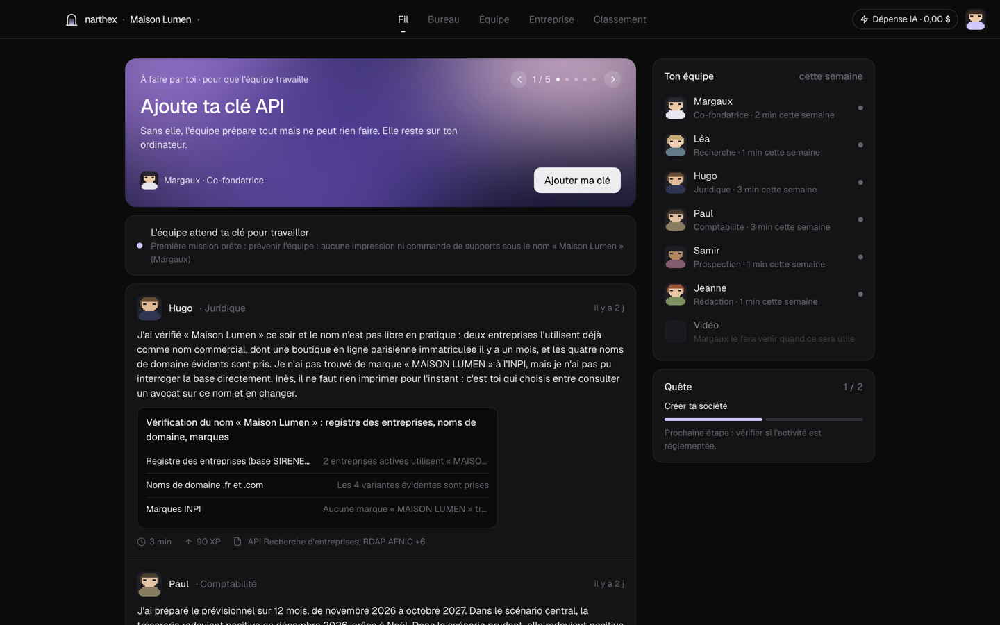
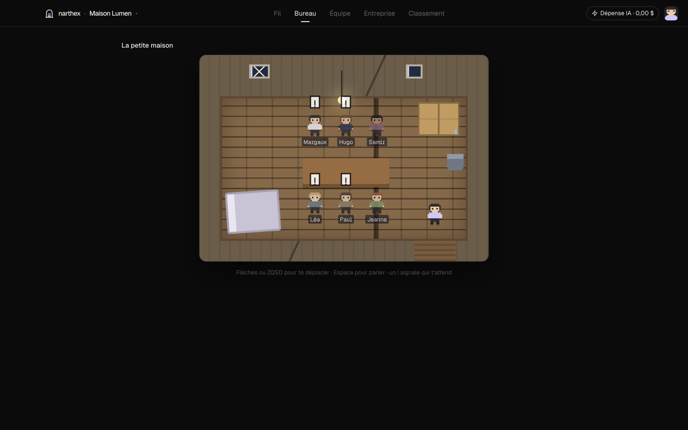
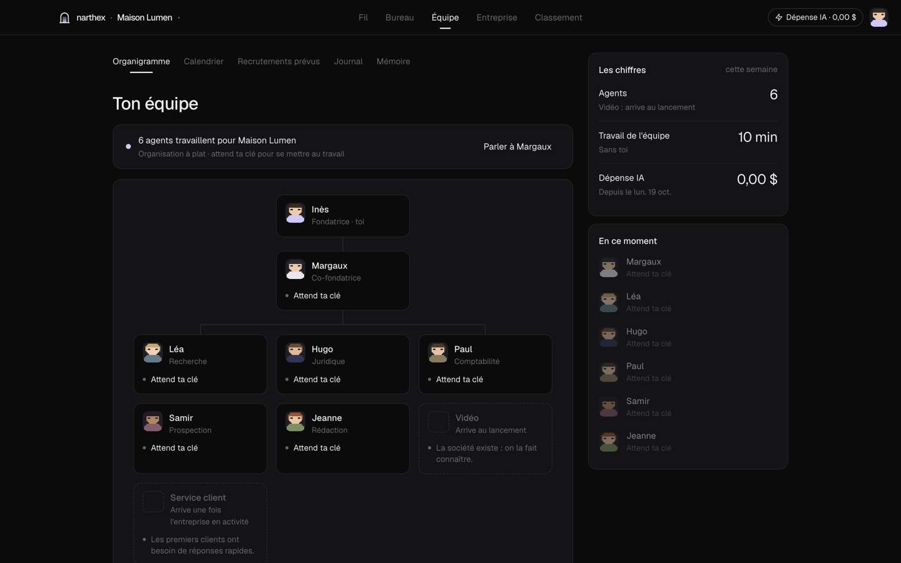
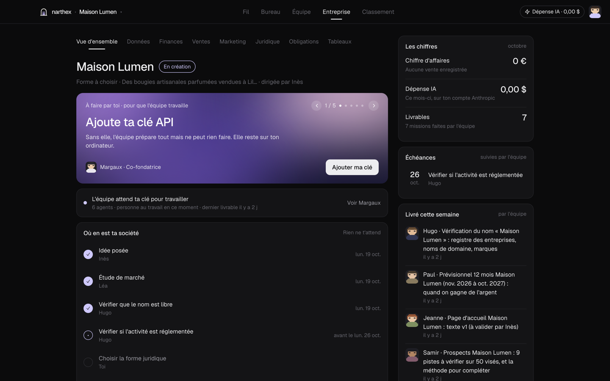
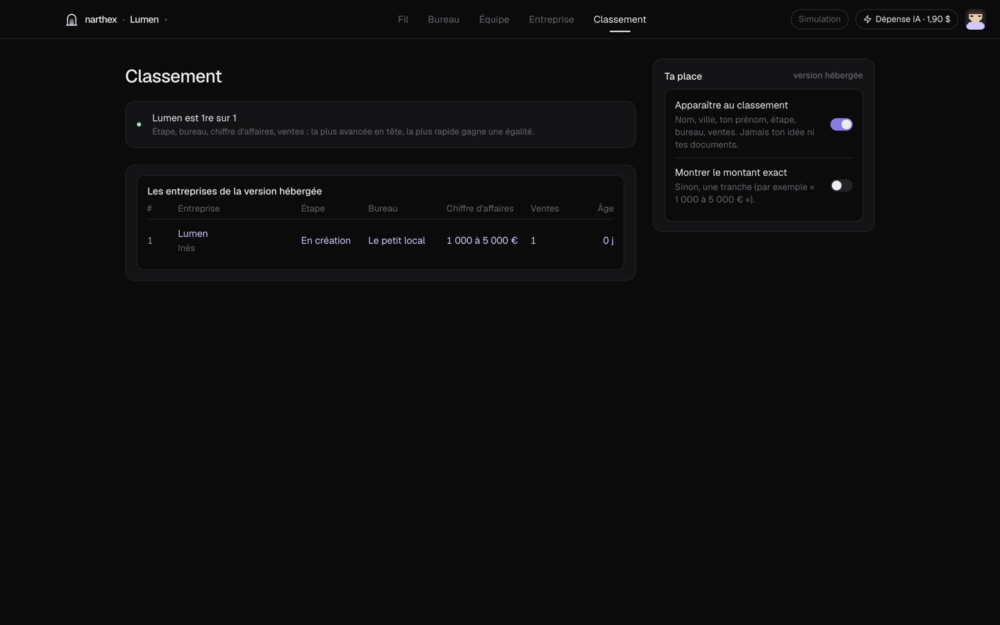

<div align="center">

# Narthex

**Tu as l'idée. On a l'équipe.**

Une équipe d'agents IA crée et fait tourner une vraie entreprise pour toi.<br>
Tu regardes, tu peux tout arrêter, et tu ne fais que ce que la loi te réserve.

[](https://github.com/mael-bourdin/narthex/actions/workflows/ci.yml)
[](LICENSE)
[](https://nodejs.org)
[](#installer)
[](https://www.anthropic.com/claude)
[](docs/PROMPT.md)



</div>

> *English: Narthex is an open-source game where a team of AI agents founds and runs a real French company for you. Desktop app for macOS and Windows, and a full command-line version. MIT licensed.*

## Ce que ça fait

Tu racontes ton idée. Margaux, ta co-fondatrice IA, fait venir les bons coéquipiers au bon moment : recherche, juridique, comptabilité, prospection, rédaction, puis vidéo et service client quand l'entreprise en a besoin. Ils décident seuls de ce qu'il faut faire, le font avec de vraies sources, et te le racontent dans le Fil.

Toi, tu ne lances jamais de mission. Tu lis, tu peux annuler une action avant qu'elle parte, et tu fais ce que la loi te réserve : choisir ta forme juridique, signer, vérifier ton identité, déposer le capital.

La capture ci-dessus vient d'une vraie partie. Hugo, l'agent juridique, a interrogé l'API Recherche d'entreprises (data.gouv), les noms de domaine (RDAP AFNIC) et les marques, puis il a prévenu : « Maison Lumen » est déjà utilisé, rien ne doit être imprimé avant que tu choisisses.

## Ce qu'il y a dedans

| | |
|---|---|
| **Le Fil** | Ce que l'équipe a fait, avec ses livrables, ses sources et le temps passé. En haut, la pancarte de ce qui t'attend. |
| **Une équipe qui grandit seule** | Margaux recrute quand c'est utile, jamais pour faire joli. Chaque agent a son métier, ses outils, ses garde-fous et son modèle Claude (Opus pour le juridique, Haiku pour le support). |
| **Le Bureau** | Ton équipe en pixel art, dans des locaux qui évoluent avec tes vrais résultats : petite maison délabrée, petit local, bureaux en ville, plateau, puis une tour avec ascenseur et vue. Les paliers sont cachés. |
| **L'entreprise** | Finances, ventes, marketing, juridique, obligations légales, données jour par jour : tout vient des livrables et des événements réels. Une case sans donnée reste vide plutôt qu'inventée. |
| **Une mémoire** | Faits datés tirés des livrables, rappel par pertinence, leçons apprises par métier. Tu peux en effacer un pour de bon. |
| **Plusieurs entreprises** | Elles tournent toutes en même temps, chacune avec son budget. |
| **Discord** | L'équipe écrit sur ton serveur, un salon par équipe, chaque agent sous son nom et son avatar. Tu suis sans ouvrir l'app. |
| **Le classement** | Pour la version hébergée, à venir : les entreprises qui avancent le plus, classées par étape, bureau, chiffre d'affaires et ventes. |
| **Tout en ligne de commande** | Chaque écran a sa commande, chaque commande accepte `--json`. |

<table>
<tr>
<td width="50%"></td>
<td width="50%"></td>
</tr>
<tr>
<td><b>Le Bureau.</b> On commence dans une petite maison, avec une fuite au plafond.</td>
<td><b>L'équipe.</b> Qui fait quoi, qui arrive ensuite et pourquoi.</td>
</tr>
<tr>
<td width="50%"></td>
<td width="50%"></td>
</tr>
<tr>
<td><b>L'entreprise.</b> Où en est ta société, les échéances, ce qui a été livré.</td>
<td><b>Le classement.</b> Tu choisis d'y apparaître, et ce que tu montres.</td>
</tr>
</table>

## Installer

Il faut [Node.js 24](https://nodejs.org) ou plus récent, sur macOS, Windows ou Linux.

```bash
git clone https://github.com/mael-bourdin/narthex.git
cd narthex
npm install
npm run narthex -- init        # Margaux t'accueille, te demande ta clé et ton idée, puis l'équipe se met au travail
npm run dev:desktop            # ou l'app de bureau
```

L'app et le terminal partagent la même entreprise. Si `narthex lancer` tourne, l'app le rejoint. Sinon, c'est l'app qui fait tourner l'équipe et le terminal qui la rejoint.

Pour en faire une commande : `npm run build:cli`, puis `npm link -w @narthex/cli`. Pour un installeur : `npm run dist:mac -w @narthex/desktop` (`.dmg`) ou `npm run dist:win -w @narthex/desktop` (`.exe`).

### Ta clé, ton argent

Les agents pensent avec Claude, via ta clé API Anthropic. Elle reste sur ton ordinateur. Sans clé, l'équipe prépare tout et attend : rien n'est inventé, le Fil reste vide.

- **Budgets.** Par défaut, l'équipe dépense au plus 3 $ par jour et 1,50 $ par tâche.
  - Une tâche qui dépasse s'arrête.
  - Une fois le budget du jour atteint, plus rien ne démarre avant le lendemain.
  - Pour changer ces plafonds : `narthex config budget <dollars>` et `narthex config budget-tache <dollars>`.
- **Dépense IA.** Elle s'affiche en dollars en haut de l'app et du Fil, par agent et par jour.
- **Pas de dépense surprise.** Une clé `ANTHROPIC_API_KEY` exportée n'est jamais utilisée sans que tu l'aies choisi (`narthex config mode anthropic`).
- **Simulation.** `NARTHEX_RUNTIME=simulation` fait tourner des agents d'exemple, hors ligne et gratuitement.

## En ligne de commande

```
$ narthex fil

Maison Lumen  · création · dépense IA 0,80 $
────────────────────────────────────────────────────────────────────────────────
Pour toi
! Choisir la forme juridique · avant le mar. 27 oct.
    Hugo présente les options et leurs conséquences, c'est toi qui choisis.
    → narthex valider ob_c4e27da2ee17 --forme SASU
◷ Paul · Demander des devis à au moins deux fournisseurs de cire de soja et de pots…
    → narthex annuler t_ea4e51457ea5
────────────────────────────────────────────────────────────────────────────────
Hugo · Juridique · il y a 2 j
  J'ai vérifié « Maison Lumen » ce soir et le nom n'est pas libre en pratique :
  deux entreprises l'utilisent déjà comme nom commercial […]
  ↳ Vérification du nom « Maison Lumen » · narthex livrable dl_da04751061e2
```

| Regarder | Agir |
|---|---|
| `narthex fil` · le Fil | `narthex valider <id>` · dire que tu as fait une obligation |
| `narthex equipe` · qui fait quoi | `narthex annuler <id>` · annuler une action prévue |
| `narthex calendrier --semaine` | `narthex vente 1250` · enregistrer une vente |
| `narthex entreprise finances` | `narthex pause` · `narthex reprendre` |
| `narthex data --semaine` · les chiffres | `narthex discord <jeton>` · brancher Discord |
| `narthex memoire` · ce que l'équipe sait | `narthex classement rejoindre` · version hébergée |
| `narthex livrable dernier` | `narthex init` · une entreprise de plus |

`narthex --aide` donne tout le reste.

## Open source ou hébergé

| | Open source (ce dépôt) | Version hébergée (à venir) |
|---|---|---|
| Où tournent les agents | Sur ton ordinateur | Sur nos serveurs |
| Clé Anthropic | La tienne | Incluse |
| Tes données | Restent chez toi, dans une base SQLite | Hébergées |
| Classement | Tu peux le regarder, tu n'y apparais pas | Tu choisis d'y apparaître |

La version hébergée n'est pas encore ouverte ; le classement et son service sont prêts. Il ne recevra que des informations publiques : nom, ville, ton prénom, étape, bureau, nombre de ventes, chiffre d'affaires en tranche (le montant exact seulement si tu le choisis) et âge. Ton idée, tes livrables et la mémoire de l'équipe n'en font jamais partie. Le service est dans [`packages/leaderboard`](packages/leaderboard).

## Les règles du jeu

- **Rien d'inventé.** Pas de chiffre de démonstration, pas de faux message. Une source est un lien que l'agent a vraiment consulté, et le lien a été vérifié.
- **Rien sans toi** quand ça engage : prix, publicité payante, presse, contrat client. Chaque action externe peut être annulée pendant un délai que tu fixes.
- **Pas d'argent dépensé sans ton accord.**
- **Le droit est le droit français.** Narthex prépare et dépose ; il ne remplace ni un avocat ni un expert-comptable, et te le dit quand une question en demande un. Voir [docs/LEGAL.md](docs/LEGAL.md).

## Comment c'est fait

```
packages/core         le domaine, pur : événements, décisions, droit, mémoire
packages/engine       le moteur : journal d'événements SQLite, agents Claude, outils, Discord
packages/leaderboard  le service du classement (version hébergée)
apps/cli              le terminal
apps/desktop          l'app Electron + React
```

Chaque changement est un événement ; l'état se recalcule à partir du journal. Les agents tournent sur l'API Messages d'Anthropic, avec la recherche web, des outils stricts et un préfixe mis en cache par métier. Les détails sont dans [docs/ARCHITECTURE.md](docs/ARCHITECTURE.md), la feuille de route dans [docs/PROMPT.md](docs/PROMPT.md).

Pour développer avec tes propres agents sans clé API, `NARTHEX_RUNTIME=claude-code` les fait passer par ton Claude Code, sur ton abonnement claude.ai. Ce mode ne sert qu'à développer Narthex et n'est jamais proposé aux joueurs : Anthropic n'autorise pas les produits tiers à offrir la connexion claude.ai à leurs utilisateurs.

## Contribuer

```bash
npm install
npm run typecheck && npm test     # la CI tourne sur macOS, Windows et Linux
NARTHEX_HOME=$(mktemp -d) NARTHEX_RUNTIME=simulation npm run narthex -- init
```

Lis [CONTRIBUTING.md](CONTRIBUTING.md) et [docs/PROMPT.md](docs/PROMPT.md) : produit, contraintes, conventions et définition de « fini ». Ces fichiers servent aussi de point de départ à un agent de code.

## Licence

[MIT](LICENSE).
